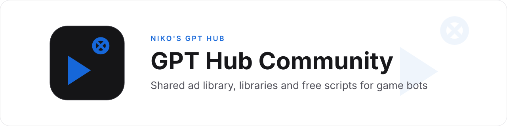
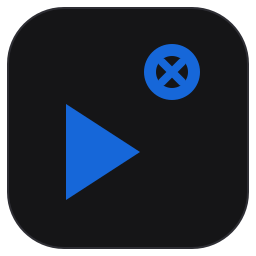
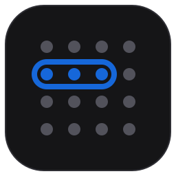
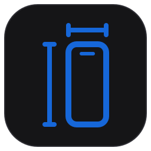

  <picture>
    <source media="(prefers-color-scheme: dark)" srcset="https://raw.githubusercontent.com/GPT-Hub-Community/.github/main/assets/banner-dark.svg">
    
  </picture>

Where Niko's GPT Hub shares what makes game bots work: the ad library every bot needs, shared libraries, and free scripts. Built by members, for members, so nobody solves the same problem twice.

| | Repository | What it is |
| --- | --- | --- |
|  | [**Not The Largest Ad Repository**](https://github.com/GPT-Hub-Community/not-the-largest-ad-repository) | Full-screen ad handling: find the close or skip button, never tap the ad. Android and iPhone. |
|  | [**wordsearch-bot**](https://github.com/GPT-Hub-Community/wordsearch-bot) | Free Word Search Explorer bot with a terminal UI, Android and iPhone. |
|  | [**screen-sizes**](https://github.com/GPT-Hub-Community/screen-sizes) | Every phone screen size for game bots: size profiles, emulator matrix, geometry. Android and iPhone. |

**Joining:** the repositories are for GPT Hub members. Ask in **#ad-repo** on the GPT Hub Discord.
**Contributing:** fork, open a pull request, follow the repo's CONTRIBUTING.md. Every repo meets [STANDARDS.md](https://github.com/GPT-Hub-Community/.github/blob/main/STANDARDS.md).
